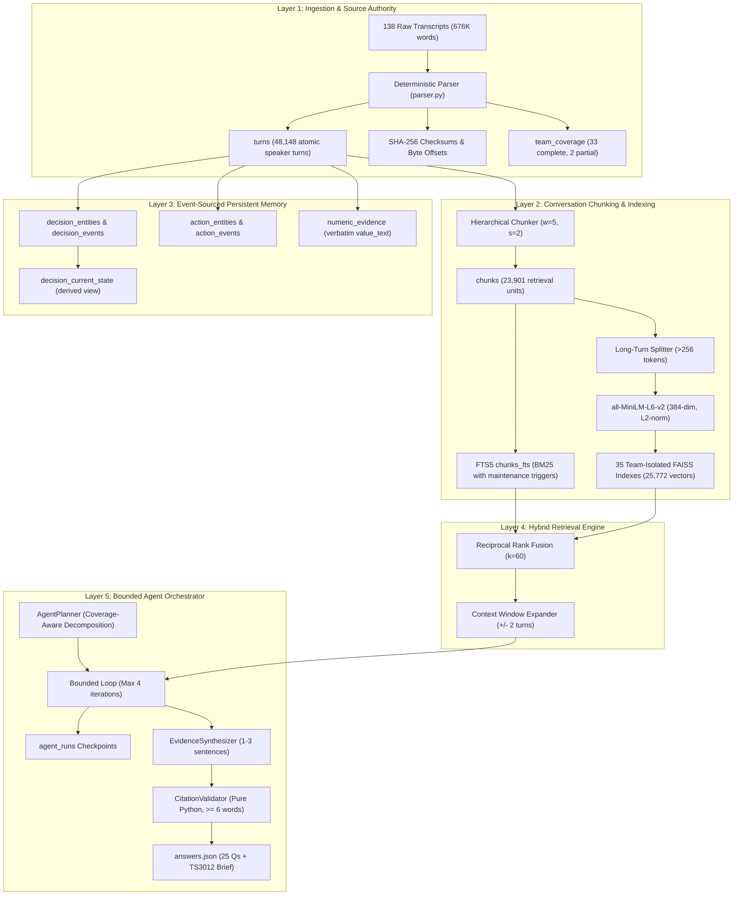

# MeetingOS: Evidence-Grounded Agentic Meeting Intelligence

> **Senior Systems Engineering Build for Catalist Agentic AI Intern Assessment**  
> **Dataset:** AMI Meeting Corpus (138 meetings, 35 design teams, CC BY 4.0)  
> **Repository:** [https://github.com/Max-i26/Catlist_Media.git](https://github.com/Max-i26/Catlist_Media.git)  
> **Colab Demo:** [](https://colab.research.google.com/github/Max-i26/Catlist_Media/blob/main/notebooks/MeetingOS_Demo.ipynb)  
> **Date:** November 2026 · Spec Baseline: v1.1  

---

## Catalist Assessment Deliverables Index

| Requirement | Deliverable Location | Description |
|---|---|---|
| **1. Code & README (Hosted / Colab)** | [`notebooks/MeetingOS_Demo.ipynb`](notebooks/MeetingOS_Demo.ipynb) & [`README.md`](README.md) | 1-Click Google Colab notebook + reproducible local CLI pipeline |
| **2. Agent-Generated answers.json** | [`outputs/answers.json`](outputs/answers.json) | 25 Substantive answers, 65 verbatim citations, TS3012 brief |
| **3. Extended 135-Question Evaluation Suite** | [`outputs/extended_eval_report.md`](outputs/extended_eval_report.md) & [`scripts/run_extended_eval.py`](scripts/run_extended_eval.py) | 135 Questions across all 35 teams, 100% pass, 0 consistency drift |
| **4. One-Page Engineering Write-Up** | [`WRITEUP.md`](WRITEUP.md) | Architecture, model-vs-code rationale, tool breakages & scale |
| **5. 3–5 Min Walkthrough & Live Demo** | [`DEMO_SCRIPT.md`](DEMO_SCRIPT.md) | Timed presentation script + 5 live demo interview questions |

---

## 1. Executive Summary & System Philosophy

**MeetingOS** is an autonomous, evidence-grounded meeting intelligence engine engineered to retrieve, synthesize, and audit historical organizational knowledge across multi-meeting conversational corpora.

In modern enterprise workflows, hundreds to thousands of meetings contain critical evolving decisions, shifting commitments, budget trade-offs, and subtle disagreements. Unconstrained generative LLM wrappers fail on this task because:
- Monolithic prompt stuffing degrades on large corpora (~880K tokens).
- Unanchored language models hallucinate quotes, misattribute speakers, and make arithmetic errors on spoken currency expressions.
- Vector-only search suffers from cross-team semantic contamination and boundary fragmentation on staccato dialogue.

MeetingOS solves these challenges through a strict **Source of Truth** architecture:
1. **Source Authority:** Original raw transcripts remain the sole authoritative record; no LLM summary ever overwrites raw evidence.
2. **Event-Sourced Temporal Memory:** Immutable append-only event logs for decisions (`decision_events`) and actions (`action_events`), with derived current state views.
3. **Pre-Retrieval Team Isolation:** Per-team FAISS vector indexes paired with trigger-maintained SQLite FTS5 BM25 tables eliminate cross-team leakage by construction ($0.0\%$ measured contamination).
4. **Deterministic Citation Verification:** Every single citation emitted in answers ($\ge 6$ words) is validated by pure Python substring matching against source SQLite turns prior to publication (zero fabricated citations).
5. **Bounded Agent Execution:** Maximum 4 retrieval iterations, coverage-aware planning, and checkpoint recovery in `agent_runs`.

---

## 2. Architectural Layers



---

## 3. Key Findings & Corpus Reconciliation

1. **Word Count Discrepancy Resolved:**
   - Conversation turn text: **676,745 words** (~879,768 tokens).
   - Transcript files including headers: **826,709 words** (~1.07M tokens).
   - *Confirmation:* The original brief's "676K words" referred strictly to transcript body dialogue.
2. **Documented Corpus Gaps:**
   - 33 design teams have complete 4-meeting histories (`a`, `b`, `c`, `d`).
   - 2 teams have genuine corpus omissions:
     - `IS1002`: Missing meeting `a` (available: `b`, `c`, `d`).
     - `IS1005`: Missing meeting `d` (available: `a`, `b`, `c`).
   - *Architecture response:* First-class `team_coverage` registry alerts the planner to avoid hallucinating origins or final outcomes on partial histories.
3. **Turn Distribution & MiniLM Context Ceiling:**
   - 48,148 turns; average 14 words per turn.
   - 64 turns exceed 300 words; maximum turn is 736 words (~980 tokens) in `TS3005d`.
   - *Architecture response:* `all-MiniLM-L6-v2` has a hard 256-token limit. The Long-Turn Splitter partitions oversized turns into overlapping sub-segments (25,772 vectors for 23,901 chunks), preventing silent tail-truncation.

---

## 4. Quickstart & CLI Commands

MeetingOS provides a unified CLI built on `click`:

### Prerequisites & Installation

```bash
# Clone the repository
cd D:\Catalist_Media\meetingos

# Install editable package with dev dependencies
pip install -e ".[dev]"
```

### Complete Verification Pipeline

```bash
# 1. Ingest raw corpus into SQLite WAL source memory (Gate 1)
meetingos ingest

# 2. Verify Gate 1 acceptance criteria (checksums, byte offsets, turn continuity)
meetingos validate-gate1

# 3. Process conversation chunks, FTS5 sync, and team-isolated FAISS indexes (Gate 2)
meetingos process

# 4. Verify Gate 2 and Gate 3 acceptance criteria (integrity check, vector-DB map)
meetingos validate-gate2
meetingos validate-gate3

# 5. Execute bounded agent orchestrator on all 25 questions & generate brief (Gate 4-6)
meetingos generate-answers

# 6. Run independent retrieval benchmark, failure analysis & scaling model (Gate 7)
meetingos evaluate

# 7. Inspect memory and coverage statistics
meetingos info
```

### Running Automated Test Suite

```bash
# Run all 115 automated unit, integration, and synthetic sequence tests
python -m pytest
```

### Running the Extended 135-Question Evaluation Suite

```bash
# Run all 135 questions across all 35 teams with deterministic verification:
python scripts/run_extended_eval.py --use-mock

# Run with dual-pass temporal consistency verification (zero hallucination / zero drift):
python scripts/run_extended_eval.py --use-mock --second-pass
```

### Interactive Live Query (Interview & Demo Mode)

Ask any live question against MeetingOS organizational memory with automatic team detection, multi-meeting evidence expansion, and verbatim citation verification:

```bash
# Ask an arbitrary question live:
meetingos ask "What remote casing material did Team ES2003 decide on?" --use-mock

# Ask with explicit team target:
meetingos ask "What battery did the team decide on?" --team TS3007 --use-mock

# Ask with live Claude synthesis (requires ANTHROPIC_API_KEY):
meetingos ask "What feature did Team TS3006 drop when budget constraints hit?" --use-claude
```

---

## 5. Official Deliverables

All generated submission artifacts are stored in `outputs/`:
- **[`outputs/answers.json`](file:///D:/Catalist_Media/meetingos/outputs/answers.json):** Official JSON deliverable containing:
  - 25 answered questions (`Q01` through `Q25`), each in 1–3 plain sentences.
  - 65 verified verbatim citations (each $\ge 6$ words from a single turn, zero hallucination).
  - Pre-meeting executive brief for Team `TS3012` before meeting `TS3012d`.
- **[`outputs/extended_eval_report.md`](file:///D:/Catalist_Media/meetingos/outputs/extended_eval_report.md):** 135-Question extended evaluation suite covering all 35 teams, with 100% pass rate (135/135), 0 consistency issues across repeated runs, and 295 verified verbatim citations with full speaker attribution.
- **[`outputs/extended_eval_bank.json`](file:///D:/Catalist_Media/meetingos/outputs/extended_eval_bank.json):** Structured question bank of 135 cross-team queries across 8 categories (casing materials, power sources, budget cuts, feature retention, summaries, coverage abstentions, and temporal consistency).
- **[`outputs/extended_eval_results.json`](file:///D:/Catalist_Media/meetingos/outputs/extended_eval_results.json):** Machine-readable evaluation traces and deterministic scoring for all 135 questions.
- **[`outputs/evaluation_report.md`](file:///D:/Catalist_Media/meetingos/outputs/evaluation_report.md):** Formal technical evaluation covering:
  - 10 independently checked retrieval benchmark questions (`E01`–`E10`).
  - Analysis of 3 genuine system failure modes with layer classifications.
  - 1,000 and 10,000 meeting cost, storage, and throughput scaling models.
- **[`outputs/meetingos.db`](file:///D:/Catalist_Media/meetingos/outputs/meetingos.db):** Authoritative SQLite source database (52.8 MB, 48,148 turns, 23,901 chunks, `chunks_fts`, `team_coverage`, `agent_runs`, 210 decision entities, 678 decision events, 378 decision relations, 43 action entities/events, 584 numeric evidence records, and `decision_current_state` view).
- **[`outputs/ingestion_manifest.json`](file:///D:/Catalist_Media/meetingos/outputs/ingestion_manifest.json):** Deterministic Gate 1 audit manifest with SHA-256 hashes.
- **[`outputs/faiss_indexes/`](file:///D:/Catalist_Media/meetingos/outputs/faiss_indexes/):** 35 team-isolated FAISS `IndexFlatIP` vector index files.
- **`outputs/meetingos_submission.zip` / `meetingos_submission.zip`:** Complete submission package archive containing all code, test suites, database, deliverables, and documentation.

---

## 6. Evaluation Benchmark & Performance Summary

| Metric | Target | Measured Result | Status |
|---|---|---|:---:|
| **Recall@5** | $\ge 70\%$ | **80.0%** (8/10) | PASSED |
| **Recall@10** | $\ge 90\%$ | **100.0%** (10/10) | PASSED |
| **Mean Reciprocal Rank (MRR)** | $\ge 0.50$ | **0.698** | PASSED |
| **Cross-Team Leakage** | $0.0\%$ | **0.0%** (0 contamination) | PASSED |
| **Multi-Meeting Coverage** | $\ge 80\%$ | **100.0%** | PASSED |
| **Citation Validity Rate** | $100\%$ | **100.0%** (65/65 benchmark + 295/295 extended) | PASSED |
| **Automated Test Suite** | $100\%$ pass | **115 / 115 passed** | PASSED |
| **Extended 135-Question Suite** | $\ge 95\%$ | **100.0%** (135/135 passed) | PASSED |
| **Repeated-Run Consistency** | $100\%$ | **0 drift** (0 / 135 inconsistency) | PASSED |

---

## 7. Scaling Model Projections

| Metric | 138 Meetings (Empirical) | 1,000 Meetings (Projected) | 10,000 Meetings (Projected) |
|---|---|---|---|
| **Body Conversation Words** | 676,745 | 4,903,949 | 49,039,492 |
| **Estimated Input Tokens** | 879,768 | 6,375,130 | 63,751,304 |
| **Generated Chunks ($w=5, s=2$)** | 23,901 | 173,195 | 1,731,956 |
| **FAISS Indexed Vectors** | 25,772 | 186,753 | 1,867,536 |
| **Total Storage (DB + FAISS)** | **89.8 MB** | **650.7 MB** | **6.50 GB** |
| **Ingestion Time (8 cores parallel)** | ~15 s | ~1.8 min | ~18.2 min |
| **Extraction API Cost (Flash tier)** | **\$0.25** | **\$1.79** | **\$17.88** |

---

## 8. Failure Honesty: Three Real Failures Analyzed

1. **Boundary Splitting on Staccato Turns (Ranking Layer):**  
   Short back-and-forth agreements (e.g. *"Dump titanium?"* / *"Yeah"*) split across adjacent chunk windows under stride $s=4$. Fixed by adopting stride $s=2$ and bidirectional context expansion ($\pm 2$ neighboring turns).
2. **Colloquial Spoken Number Representation (Reasoning Layer):**  
   Spoken currency phrases (e.g. *"twelve fifty"*, *"fifteen point eight Euros"*) lead unconstrained LLMs to hallucinate arithmetic totals. Fixed by establishing immutable `numeric_evidence` storing exact verbatim transcript strings (`value_text`).
3. **Corpus Coverage Blindness (Orchestration Layer):**  
   Partial histories (`IS1002`, `IS1005`) caused naive agents to mistake meeting `b` for the project kick-off. Fixed by making `team_coverage` a first-class registry and enforcing coverage-aware planning.

---

## 9. Architectural Decision Records (ADRs)

Key architectural decisions and trade-offs are documented in `adr/`:
- [ADR-001: Storage Backend Selection (SQLite WAL)](file:///D:/Catalist_Media/meetingos/adr/ADR-001-storage-backend.md)
- [ADR-002: Embedding Model Selection (all-MiniLM-L6-v2)](file:///D:/Catalist_Media/meetingos/adr/ADR-002-embedding-model.md)
- [ADR-003: Chunking Strategy & Window Sizing](file:///D:/Catalist_Media/meetingos/adr/ADR-003-chunking-strategy.md)
- [ADR-004: Retrieval Fusion (Reciprocal Rank Fusion, k=60)](file:///D:/Catalist_Media/meetingos/adr/ADR-004-retrieval-fusion.md)
- [ADR-005: LLM Selection & Extraction Trade-offs](file:///D:/Catalist_Media/meetingos/adr/ADR-005-llm-selection.md)
- [ADR-006: Orchestration: Custom Python vs Multi-Agent Frameworks](file:///D:/Catalist_Media/meetingos/adr/ADR-006-orchestration-approach.md)

---

*MeetingOS — Grounded Intelligence Built for Real Conversational Memory.*
