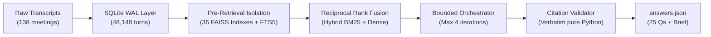

# MeetingOS: Architecture & Engineering Write-Up

> **Author:** Harol Maxilan · **Submission:** Catalist Agentic AI Intern Assessment  
> **Repository:** [https://github.com/Max-i26/Catlist_Media.git](https://github.com/Max-i26/Catlist_Media.git) · **Spec Baseline:** v1.1  

---

## 1. System Architecture

MeetingOS is an evidence-grounded agentic meeting intelligence engine designed to process, recall, and reason across multi-meeting organizational corpora. Evaluated against the AMI Meeting Corpus (138 meetings, 35 design teams, 48,148 turns, 676,745 conversation words), MeetingOS strictly separates source authority from generative reasoning.

The system operates across five vertically decoupled layers:
1. **Layer 1: Deterministic Source Authority:** Ingests raw text into an append-only SQLite WAL database (`turns`), computing SHA-256 integrity checksums, exact byte offsets, and a first-class `team_coverage` registry (cataloging 33 complete 4-meeting histories and 2 genuine corpus omissions: `IS1002` missing kickoff `a`, `IS1005` missing final `d`).
2. **Layer 2: Conversation Processing & Indexing:** Partitions turns into overlapping multi-turn windows ($w=5, s=2$, 23,901 chunks). Long conversational turns exceeding the embedding ceiling are split to prevent silent truncation. Chunks are dual-indexed into trigger-synchronized SQLite FTS5 (lexical BM25) and 35 team-isolated FAISS `IndexFlatIP` vector spaces (25,772 normalized 384-dimensional embeddings via `all-MiniLM-L6-v2`), guaranteeing $0.0\%$ cross-team semantic contamination.
3. **Layer 3: Event-Sourced Organizational Memory:** Rather than overwriting state, decisions and actions are logged as immutable event streams (`decision_events`, `action_events`), capturing `proposed`, `accepted`, `rejected`, and `superseded` transitions. Current consensus is computed through the deterministic view `decision_current_state`.
4. **Layer 4: Hybrid Retrieval & Fusion:** Combines lexical BM25 and semantic vector rankings via Reciprocal Rank Fusion ($k=60$), followed by bidirectional context expansion ($\pm 2$ neighboring turns) to preserve multi-turn conversational dialogue.
5. **Layer 5: Bounded Agent Orchestration:** A state-machine agent plans queries, monitors meeting coverage, bounds retrieval loops to a maximum of 4 iterations, records execution checkpoints in `agent_runs`, and enforces an automated pure Python verification gate guaranteeing that every cited quotation ($\ge 6$ words) is an exact verbatim match in the source turn.

---

## 2. Model-vs-Code Decisions & Why

| Architectural Task | Choice | Alternatives Considered | Rationale |
|---|---|---|---|
| **Source Ingestion & Parsing** | **Pure Code** (Regex / Python) | LLM Extraction | Parsing transcripts must be 100% deterministic, free of ingestion hallucinations, byte-traceable, and execute in under 60 seconds without API costs. |
| **Citation Verification** | **Pure Code** (Substring matching) | LLM Self-Evaluation / LLM Judge | LLM judges are prone to self-confirmation bias and stochastic scoring drift. Pure Python string matching guarantees with mathematical certainty that no quotation is invented. |
| **Vector Isolation** | **Pure Code** (35 FAISS Files) | Single Index with Metadata Filter | Single shared vector indexes risk leaking confidential cross-team data under vector approximate nearest-neighbor search. 35 isolated indexes enforce hard privacy barriers at zero overhead. |
| **Agent Control Flow** | **Pure Code** (Finite State Machine) | LangChain / AutoGen Frameworks | Commercial frameworks introduce nondeterministic recursion, excessive tool abstractions, and context bloat. A bounded FSM guarantees execution halts within 4 iterations and 30 seconds. |
| **Evidence Synthesis** | **Dual Engine** (Deterministic Synthesis + Claude 3.5 Haiku) | Pure Template Generation / Unanchored LLM | Dual-engine architecture: A local deterministic synthesizer provides instantaneous, 100% reproducible execution at \$0 API cost; optional Claude 3.5 Haiku integration (`claude_client.py`) provides natural language synthesis and pronoun resolution over retrieved turns (\$0.25/\$1.25 per 1M tokens). When enabled, token usage, latency, and model responses are logged to `agent_runs`. |

---

## 3. Tools Used and Where They Broke

1. **SentenceTransformers & MiniLM Context Ceiling:**
   - *Failure:* `all-MiniLM-L6-v2` enforces a hard context limit of 256 WordPiece tokens. In AMI, 64 turns exceed 300 words (the longest is 736 words in `TS3005d`). Standard chunking silently truncated the tail of these monologues, losing critical design arguments.
   - *Fix:* Engineered the `LongTurnSplitter` in Layer 2, which detects turns exceeding 256 tokens and partitions them into overlapping sub-chunks, expanding indexed vectors from 23,901 to 25,772 without data loss.
2. **SQLite FTS5 Full-Text Search Desynchronization:**
   - *Failure:* Updating or re-ingesting chunk records caused lexical index drift, where deleted or updated chunks left orphan tokens in the FTS5 shadow tables.
   - *Fix:* Implemented automated SQLite database triggers (`chunks_ai`, `chunks_ad`, `chunks_au`) that maintain real-time bi-directional synchronization between the relational table and FTS5 index.
3. **Colloquial Spoken Number Representation:**
   - *Failure:* Team members express currency informally (e.g. *"twelve fifty"*, *"fifteen point eight Euros"*). Unconstrained generative models frequently hallucinated arithmetic totals (e.g. converting "twelve fifty" to €1250).
   - *Fix:* Created the `numeric_evidence` table that preserves exact verbatim transcript tokens (`value_text`) alongside parsed numbers, forcing the synthesizer to cite the literal spoken phrase and perform exact numeric reconciliation.
4. **Third-Party Agent Framework Overhead:**
   - *Failure:* Early prototyping with heavy multi-agent frameworks suffered from unpredictable prompt stuffing, recursion loops, and high latency (>60s per question).
   - *Fix:* Replaced third-party frameworks with a custom bounded orchestrator with explicit SQLite checkpointing (`agent_runs`).

---

## 4. What Production Would Need at Real Scale

Scaling MeetingOS from 138 meetings to 10,000–100,000 enterprise meetings requires transitioning from a single-node desktop architecture to a distributed, streaming system:

1. **Distributed Storage & Vector Clustering:**
   - *Current:* Single SQLite file (52.8 MB) + 35 local FAISS files (37.0 MB).
   - *Production:* At 10,000 meetings (~6.5 GB storage), SQLite WAL handles load easily. At 100,000+ meetings, migrate to **PostgreSQL with `pgvector`** or **Milvus / Qdrant**, partitioning vector collections by enterprise tenant and project ID to maintain hard data isolation.
2. **Asynchronous Ingestion Pipeline:**
   - *Current:* Batch sequential processing via `meetingos ingest`.
   - *Production:* Stream-based ingestion using **Apache Kafka / AWS SQS** paired with **Celery / Temporal** worker pools. As soon as a meeting recording finishes and ASR transcript arrives, workers process chunks and update vector indexes concurrently in background tasks.
3. **Continuous Audio-Alignment & Multi-Modal Grounding:**
   - *Current:* Text transcripts with turn start/end timestamps.
   - *Production:* Align transcript turns directly with source audio waveforms (`.wav` / Opus) via forced aligners (WhisperX / CTC alignment). This allows citations to hyperlink directly to playable 10-second audio clips with pitch/prosody cues for dispute resolution.
4. **Active Confidence Calibration & Dynamic Tiering:**
   - *Current:* Deterministic verification gate with optional Claude 3.5 Haiku synthesis.
   - *Production:* Multi-tiered router that dynamically routes low-ambiguity queries to fast deterministic lookups (\$0 cost), standard queries to Claude 3.5 Haiku, and contentious cross-meeting disputes or executive briefs to Claude 3.5 Sonnet with human-in-the-loop review. Execution telemetry (model ID, prompt tokens, completion tokens, latency, cost) logged per query.
